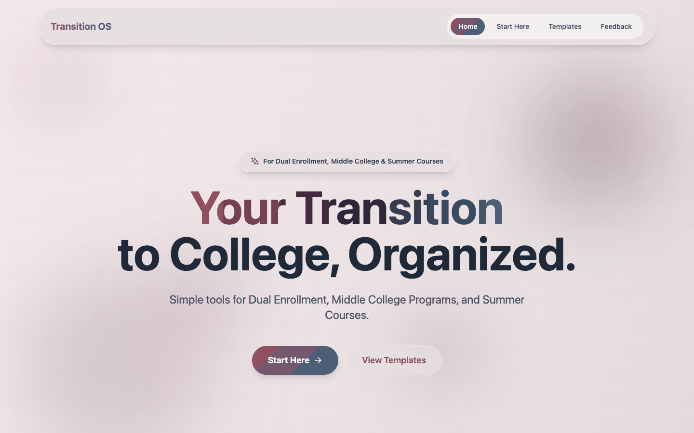

<p align="center">
  
</p>

# Transition OS

A free library of Google Sheets templates and guides for high schoolers taking college classes through dual enrollment, middle college or summer programs.

**Live:** <https://transition-os.vercel.app>

## Why

Students in dual enrollment end up juggling a high-school calendar, a college portal, and syllabi that each work differently. Transition OS gathers the planning tools for that in one place, so the first semester feels organized instead of scattered.

## What it does

- **Start here** and **Quickstart** guides that walk a new student through setting up.
- **Templates:** copy-ready Google Sheets for a weekly schedule, assignment and exam tracking, tasks and projects, a personal budget, and an XP / streak habit tracker.
- **Guides** on using each template, planning a week across high school and community college, a middle-college starter kit, and GPA and transcripts.
- A **GPA calculator** that calculates GPA using your school district's rules.
- An FAQ and a feedback page.

## Design

The goal was a calm app rather than a school website: dusty-rose-to-slate gradients, frosted-glass pills, big rounded cards and slow floating blobs in the background.

| | |
|---|---|
| Type | System sans; bold display headings (up to 96 px) with gradient-clipped text |
| Color | `#9D5060` rose (primary) · `#376380` slate blue · `#2D1F30` plum · `#f5e8eb` to `#d8cdd1` page gradient |
| Motion | Framer Motion: 0.2 s route transitions, staggered 0.3–0.4 s entrances, hero parallax, 7–10 s ambient blob drift that turns off under `prefers-reduced-motion` |

## My role

Created with Zayan Ahmad.

## Run locally

```bash
npm install
npm run dev
```

## Scripts

- `npm run dev`: start the local dev server
- `npm run build`: build for production
- `npm run preview`: preview the production build
- `npm run lint`: run ESLint
- `npm run typecheck`: run TypeScript checks

## Tech stack

- React + TypeScript
- Vite
- Tailwind CSS
- Framer Motion
- React Router

## Project structure

- `src/pages`: route-level pages
- `src/components`: shared UI components
- `src/index.css`: global styles
- `src/main.tsx`: app entry point

## Deploy

Hosted on Vercel. Build the production bundle with `npm run build` and serve the `dist` directory.
